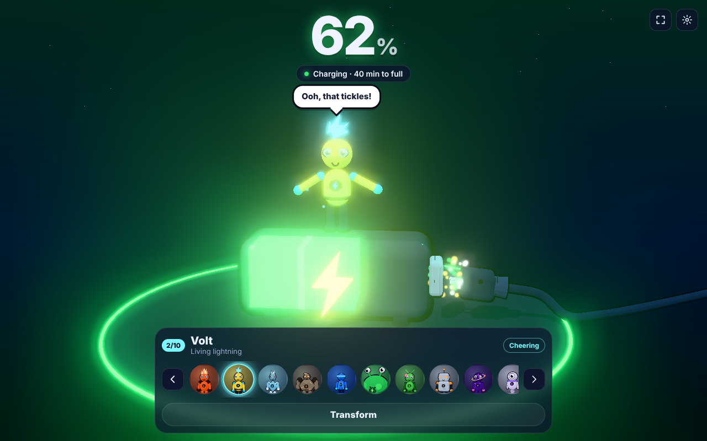
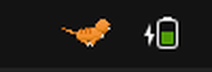
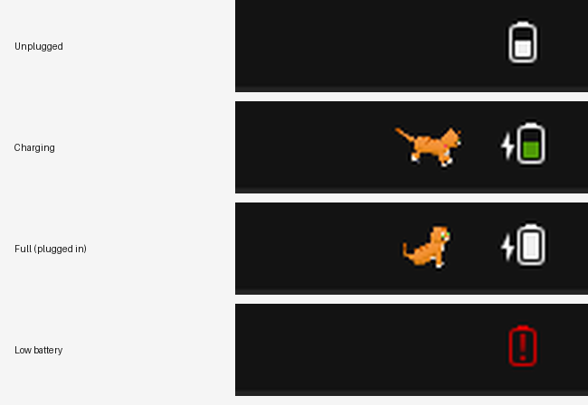
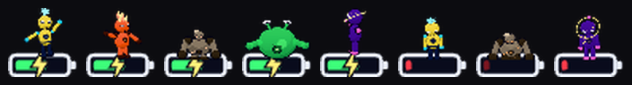

# Charger Pet ⚡



A 3D pet that lives on your **charge icon**. A cartoon battery shows your real battery
level, and one of **10 animated heroes** stands on top of it and acts out what the
battery is doing:

- **Plug in:** the cable slides into the battery, energy orbs flow up the wire, the bolt
  lights up and the hero cheers. It can also transform into a random hero.
- **Charging:** the hero dances, powers up, runs laps, does backflips, spins and pumps
  energy into the battery.
- **Full:** a victory celebration.
- **On battery:** the hero chills, waves and stretches.
- **Low battery:** the hero droops, naps and begs you to plug it in.

Tap a hero to make it react, drag to look around the 3D scene, and use the dial to switch
heroes. The browser-tab icon (favicon) and page title also show the live charge level.

It comes in two forms:

- **Desktop tray app** (Windows, macOS, Ubuntu/Linux): the pet lives in the top bar or
  system tray, right next to the system battery icon.
- **Web app / PWA** (phones and browsers): the full-screen 3D scene.

## Charger Cat for Ubuntu (recommended)



A GNOME Shell extension that puts the cat **right next to Ubuntu's own battery icon**.
There's no separate app and no second battery icon. It reads the same charger state as
GNOME's battery indicator (UPower).



| Battery | Cat |
|---|---|
| Charging (⚡) | Runs next to the battery icon |
| Full, still plugged in | Sits beside it and wags its tail |
| Unplugged | Hidden |

Install (no sudo needed), then **log out and back in once**:

```bash
curl -fsSL https://raw.githubusercontent.com/jaisudhakar/charger-pet/HEAD/scripts/install-gnome-cat.sh | bash
```

Pick another cat by adding its name: `… | bash -s -- smokey` (grey) or `… | bash -s -- snowball` (white).
To remove it: `curl -fsSL https://raw.githubusercontent.com/jaisudhakar/charger-pet/HEAD/scripts/uninstall-gnome-cat.sh | bash`.

Works on GNOME 42–49 (Ubuntu 22.04 and newer). The extension lives in
[`gnome-extension/`](gnome-extension/). Its frames are rendered from the 3D cat with
`scripts/render-cat-frames.mjs`, and `scripts/build-gnome-extension.mjs` builds
`extension.js` from `gnome-extension/src/core.js`.

## Desktop tray app




The tray icon is a tiny 3D **cat** standing on a mini charge icon (RunCat-style):

- **Charging:** the cat gallops non-stop and a lightning bolt pulses on the mini battery.
- **Fully charged:** it sits, purrs and wags its tail.
- **On battery:** it sits, grooms, strolls and stretches.
- **Low battery:** the fill turns red and blinks, and the cat curls up and naps.
- **Plugging in:** the full 3D scene pops up next to the tray for a few seconds, with the
  cat doing zoomies across the battery, then hides itself.

Three cats come with it: **Ginger** (default), **Smokey** and **Snowball**. You can also
switch to any of the 10 heroes. Heroes transform into a random hero when you plug in.

The icon sits where each OS puts app icons:

| OS | Where the pet appears | How to open the menu |
|---|---|---|
| Ubuntu / Linux | Top bar, with the other app indicators left of Wi-Fi, volume and battery | Click the pet |
| macOS | Menu bar, next to the battery icon | Left-click opens the 3D scene, right-click the menu |
| Windows | Taskbar system tray, near the battery icon (drag it out of the ^ overflow to keep it visible) | Left-click opens the 3D scene, right-click the menu |

> No app can draw *inside* the system's own battery icon. Windows, macOS and GNOME don't
> allow it. The pet sits right next to it, the same way RunCat does.

The menu lets you pick a cat or any of the 10 heroes, transform at random, turn the
plug-in pop-up and hero transform on or off, and start the pet at login.

### Install

**Ubuntu**: one command downloads, installs and starts it:

```bash
curl -fsSL https://raw.githubusercontent.com/jaisudhakar/charger-pet/HEAD/scripts/install-ubuntu.sh | bash
```

**Windows / macOS**: download the installer from the
[latest release](https://github.com/jaisudhakar/charger-pet/releases/latest).

### Run from source

```bash
npm install
npm run desktop
```

### Build installers

```bash
npm run dist:linux   # dist/*.AppImage and dist/*.deb (Ubuntu)
npm run dist:win     # dist/*.exe   (run on Windows)
npm run dist:mac     # dist/*.dmg   (run on macOS)
```

To build all three at once, open the repo's **Actions** tab and run **Build desktop app**.
It builds on Windows, macOS and Ubuntu and attaches the installers to the run. Pushing a
`v*` tag also triggers it.

Notes:
- **Ubuntu:** install with `sudo apt install ./charger-pet_*_amd64.deb`, or make the
  `.AppImage` executable and run it. Stock Ubuntu shows tray icons out of the box. On
  plain GNOME, install the *AppIndicator and KStatusNotifierItem Support* extension.
- **Unsigned installers:** they aren't code-signed. On macOS, right-click the app →
  **Open** the first time. On Windows, choose **More info → Run anyway** in SmartScreen.
- **Battery:** the app reads the battery through Chromium on all three systems (UPower
  on Linux). A desktop PC without a battery shows as 100% and plugged in.

### Cat not showing in the Ubuntu top bar?

When you open Charger Pet from the app menu, the cat window pops up for a few seconds,
then the cat stays in the top bar. If you don't see the window:

1. **Check that it's running:** run `charger-pet` in a terminal. Any error it prints
   explains why it can't start.
2. **Check the top-bar icon support:** Ubuntu shows app icons through the *Ubuntu
   AppIndicators* extension. Check it with `gnome-extensions list --enabled | grep -i appindicator`.
   If nothing prints, turn it on with `gnome-extensions enable ubuntu-appindicators@ubuntu.com`
   (or install `gnome-shell-extension-appindicator` on plain GNOME), then log out and back in.
3. **Running from source** (`npm run desktop`) on Ubuntu 24.04 can fail with a "SUID
   sandbox" error. Use the installed `.deb`, which sets up the needed AppArmor profile,
   or run `npx electron . --no-sandbox` for a quick test.

## The cats

| Cat | Look |
|---|---|
| Ginger | orange tabby, green eyes, red collar |
| Smokey | grey tabby, amber eyes, blue collar |
| Snowball | fluffy white, blue eyes, pink collar |

Cats have their own four-legged rig and moves: gallop, walk, sit, groom, stretch, pounce,
happy tail-wag, mope and nap. Each wears a collar with a glowing bolt tag.

## The Charge Squad (10 heroes)

| # | Hero | Power | Particle effect |
|---|------|-------|-----------------|
| 1 | Blaze | Fire elemental | rising embers |
| 2 | Volt | Living lightning | electric sparks |
| 3 | Frostbyte | Ice crystal | snowfall |
| 4 | Boulder | Rock golem | dust |
| 5 | Zip | Super speed | speed streaks |
| 6 | Gloop | Slime shifter | bubbles |
| 7 | Sprout | Plant power | petals |
| 8 | Gizmo | Robo tinkerer | workshop sparks |
| 9 | Nova | Cosmic star | twinkling stars |
| 10 | Wisp | Phantom spirit | mist |

All heroes are built in code from 3D primitives (cel shading, outlines, bloom glow).
They share one rig, so every hero can do all 13 activities: idle, wave, jump, backflip,
dance, spin, run, power up, cheer, pump, stretch, sad and sleep.

## Web app

```bash
npm start          # serves the app at http://localhost:8080 (no install needed)
```

Any static file server works too, for example `python3 -m http.server`.

### On your phone

1. Host the folder over HTTPS. For example, turn on **GitHub Pages** for this repo
   (Settings → Pages → Deploy from a branch → root).
2. Open the page in **Chrome on Android** and choose **Add to Home screen**. It installs
   as a full-screen app that works offline.
3. Open it, plug in your charger and watch the pet react. With "Keep the screen on while
   charging" turned on, it works like a charging screen.

## Battery support

The app reads the real battery level through the
[Battery Status API](https://developer.mozilla.org/docs/Web/API/Battery_Status_API).
This works in Chrome, Edge and other Chromium browsers, including Android. Safari and
Firefox don't support the API, so the app switches to **demo mode** there. In demo mode
the **Plug in cable** button and the level slider in Settings simulate charging. You can
also turn on demo mode yourself in Settings.

## Controls

| Action | Input |
|---|---|
| Switch hero | dial, ◀ ▶, or keys ← → / 1–0 |
| Random transform | **Transform** button |
| Make the hero react | tap or click it |
| Look around | drag |
| Plug in/unplug (demo) | **Plug in cable** button or key **P** |

## Project layout

```
index.html            page, HUD and import map
css/style.css         HUD styling (responsive for phone portrait and landscape)
js/main.js            scene, camera, bloom, UI, battery wiring
js/cat.js             the cats: four-legged rig, cat activities and director
js/characters.js      the 10 hero definitions and the shared rig
js/pets.js            one interface over cats and heroes
js/activities.js      pose-based activities and the director that picks them
js/charger.js         3D battery/charge icon, plug, cable and energy orbs
js/particles.js       GPU point-sprite particles
js/battery.js         Battery Status API and demo simulator
js/extras.js          live favicon, sound effects, screen wake lock
desktop/main.js       Electron tray app: tray icon, menu, plug-in pop-up, login item
desktop/tray.js       renders the animated tray icon frames and reads the battery
desktop/preload.cjs   bridge between the tray app and its pages
sw.js                 offline cache (PWA)
vendor/three/         Three.js r170 (MIT), bundled so it works offline
```

### Adding a hero

Add an entry to `HEROES` in `js/characters.js` with colours, body proportions and an
optional `decorate(rig, ctx)` function for accessories. The shared rig and activities do
the rest.
