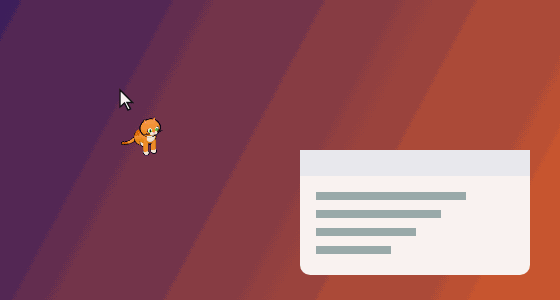

# Cursor Cat 🐈

A 3D cat that chases your mouse pointer around the screen, on **Ubuntu, Windows and
macOS**. When it catches up it sits next to the pointer, grooms, yawns and falls asleep.
Move the mouse and it wakes up and runs after it again.



- **Runs in 8 directions:** facing you when it runs down, showing its back when it runs up.
- **Never gets in the way:** clicks go straight through the cat to whatever is below.
- **Stays on top:** it draws above all your windows.
- **Three cats:** Ginger, Smokey (grey) and Snowball (white).

## Install

### Ubuntu (GNOME, Wayland or X11)

```bash
curl -fsSL https://raw.githubusercontent.com/jaisudhakar/charger-pet/HEAD/scripts/install-ubuntu.sh | bash
```

Then **log out and log back in once**. No sudo is needed.

- **Choose a cat and size:** `… | bash -s -- smokey large`. Cats are `ginger`, `smokey` or `snowball`; sizes are `small`, `medium` or `large`.
- **Remove it:** `curl -fsSL https://raw.githubusercontent.com/jaisudhakar/charger-pet/HEAD/scripts/uninstall-ubuntu.sh | bash`

On Ubuntu the cat is a GNOME Shell extension, part of the desktop itself. That's why it can
follow the pointer under Wayland, where normal apps aren't allowed to see the pointer
outside their own windows. It needs GNOME 42 or newer (Ubuntu 22.04+).

### Windows and macOS

Download the installer from the [latest release](https://github.com/jaisudhakar/charger-pet/releases/latest):

- **Windows:** `Cursor.Cat.Setup.*.exe`. If SmartScreen warns you, choose *More info → Run anyway*. The installers aren't code-signed.
- **macOS:** the `.dmg` for your Mac (`arm64` for Apple Silicon, otherwise Intel). Drag the app to Applications, then right-click it and choose **Open** the first time.

The cat lives in the tray (Windows) or menu bar (macOS). From there you can:

- hide or bring back the cat
- choose the cat
- set its size and speed
- start it at login
- quit

### Other Linux desktops (X11)

`Cursor.Cat-*.AppImage` from the release works on X11 desktops. It needs `xdotool`
(`sudo apt install xdotool`).

## How the cat behaves

| You | The cat |
|---|---|
| Move the pointer away | Ears up for a moment, then runs after it |
| Stop moving | Sits just below and to the right of the pointer, so it never covers what you point at |
| Wait 4 s | Grooms |
| Wait ~10 s | Yawns and curls up to sleep (z z z) |
| Move again | Wakes up and chases |

## Development

```bash
npm install
npm start            # run the Windows/macOS/Linux app from source (on Ubuntu, use the extension below)
npm test             # brain tests
npm run build:gnome  # rebuild the GNOME extension after changing its sources
bash scripts/install-ubuntu.sh   # install the GNOME extension from this checkout
```

| Path | What it is |
|---|---|
| `shared/brain.js` | The cat's behaviour: chasing, resting, sleeping, which sprite to show. It is shared by both versions. |
| `app/` | Electron app: a transparent, click-through window that follows the pointer, plus the tray menu |
| `gnome/src/core.js` | GNOME Shell extension. `scripts/build-gnome.mjs` combines it with the brain into `gnome/cursor-cat@…/extension.js`. |
| `sprites/<cat>/` | Pre-rendered animation frames (128×128) |
| `tools/sprites/` | The 3D cat model and the renderer that makes the sprites (`npm run sprites`, needs Playwright) |
| `scripts/` | Ubuntu install/uninstall scripts and the GNOME build |

On Linux, `npm start` runs Electron without its sandbox when `chrome-sandbox` isn't
setuid root (Ubuntu 23.10+ blocks the other sandbox mode). Installed builds don't need
this.

Releases are built by the **Build and release** workflow (Actions tab → Run workflow),
which publishes `v<version from package.json>`.

Inspired by the classic *Neko* desktop cat.
